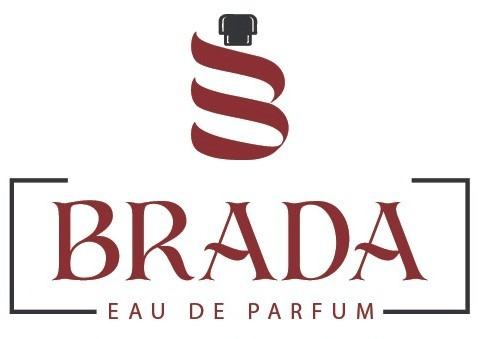

# 🌟 Brada Perfume - لوحة تحكم الإعلانات والمبيعات

  

  <strong>Brada Perfume Ads Dashboard</strong> 
  لوحة تحكم احترافية لإدارة حسابات الإعلانات والمبيعات والأرباح

---

## ✨ المميزات

### 📊 الصفحة الرئيسية
- نظرة عامة على المصروفات والمبيعات والأرباح
- أرصدة المصروفات المتبقية (صاحب المشروع / عمرو)
- المنتجات الأكثر مبيعاً
- رسوم بيانية تفاعلية

### 💸 إدارة المصروفات
- مصروفات يومية وشهرية
- تقسيم حسب المصدر (صاحب المشروع / عمرو)
- تصنيفات متعددة (فيسبوك، جوجل، تيك توك، انستجرام، شحن، تغليف...)
- فلاتر متقدمة

### 🔄 نظام سداد المصروفات
- تسجيل عمليات السداد
- خصم تلقائي من الرصيد
- عرض المتبقي لكل شخص

### 🛒 إدارة المبيعات
- تسجيل المبيعات مع بيانات العميل الكاملة
- المنتجات الأكثر مبيعاً (ترتيب 🥇🥈🥉)

### 👥 سجل العملاء
- بيانات كاملة (اسم، موبايل، عنوان، محافظة)
- تاريخ المشتريات لكل عميل
- بحث سريع

### 📦 إدارة المنتجات
- تكلفة المنتج وسعر البيع
- حساب هامش ونسبة الربح تلقائياً
- متابعة المخزون

### 📈 الأرباح والتقارير
- تحليل شامل للأرباح
- تقارير بفترة زمنية
- تصدير CSV

---

## 🚀 التشغيل

افتح ملف `index.html` في المتصفح مباشرة — لا يحتاج سيرفر!

## 🌐 GitHub Pages

الموقع متاح على: `https://YOUR_USERNAME.github.io/brada-dashboard/`

---

© 2026 Brada Perfume - All Rights Reserved

